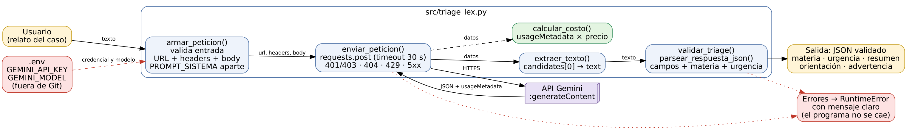

# Decisión de arquitectura: elección de modelo

Fecha: 2026-10-23

## Modelo elegido

`gemini-3.5-flash-lite`

## Diagrama de arquitectura

El flujo recorre `armar_peticion` → `enviar_peticion` → `extraer_texto` → `validar_triage`.
La credencial vive en `.env` (fuera de Git) y `calcular_costo` usa el `usageMetadata` de la respuesta.
Los errores del proveedor se traducen a mensajes claros sin detener el programa.

## Comparación de candidatos

Datos medidos con `scripts/comparar_modelos.py` el 2026-10-23: 5 peticiones por modelo, el mismo
caso de prueba (ver `comparacion_modelos.json`). Precios de la página oficial de Google
(https://ai.google.dev/gemini-api/docs/pricing, nivel de pago estándar, consultada el 2026-10-23).

| Criterio | gemini-3.1-flash-lite | gemini-3.5-flash-lite |
|---|---|---|
| Precio entrada (USD/1M tokens) | 0.25 | 0.30 |
| Precio salida (USD/1M tokens) | 1.50 | 2.50 |
| Latencia promedio (s) | 9.10 (rango 1.58 a 23.91) | 2.27 (rango 2.12 a 2.46) |
| Tokens entrada / salida (prom.) | 345.0 / 197.5 | 345.0 / 191.0 |
| Costo promedio por petición (USD) | 0.000383 | 0.000581 |
| Respuestas válidas | 4/5 (1 timeout) | 5/5 |

Un tercer candidato, `gemini-2.5-flash-lite`, se probó primero, pero la API respondió 404 en los
5 intentos con esta credencial, por lo que no pudo compararse.

## Justificación

El triage de Lex Innova es la primera capa del flujo: debe responder rápido y de forma confiable,
porque la persona espera el resultado en pantalla. `gemini-3.5-flash-lite` respondió 5 de 5 veces
con una latencia estable (alrededor de 2,3 s), mientras que el otro candidato tuvo un timeout y una
respuesta de casi 24 s. La diferencia de costo es de unos US$0,0002 por petición: a 10.000 casos
al mes serían cerca de US$2 más, un valor pequeño frente a la previsibilidad ganada. La tarea
(clasificar y orientar en JSON corto) no exige un modelo mayor.

## Alternativa descartada y por qué

Se descartó `gemini-3.1-flash-lite`: es 34 % más barato por petición, pero su latencia promedio
fue cuatro veces mayor, con una variación muy alta, y falló 1 de 5 peticiones. Para una primera
interacción con el usuario, la estabilidad pesa más que el ahorro. Con solo 5 mediciones la
conclusión es orientativa; conviene repetirla con más peticiones antes de producción.
